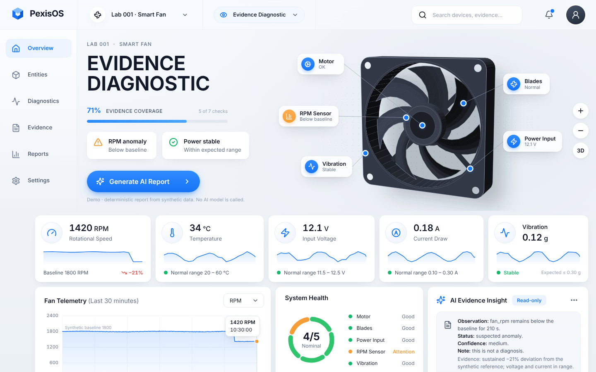

# PexisOS Console V1

First visual interface of PexisOS: **Lab 001 · Smart Fan**, mode **Evidence Diagnostic**, light theme.



> [!IMPORTANT]
> **Demonstration with synthetic data.** Every reading in the console is generated in code
> (`src/domain/scenario.ts`). No hardware is connected, nothing is read from a device, and no
> number describes any physical fan. The console makes **no network requests** and calls **no AI
> model**: "Generate AI Report" fills a deterministic template. Nothing it shows is a diagnosis.

It is an isolated frontend under `apps/console`. It does not import, call or change the Python
runtime, its APIs, its contracts or the Agent Fabric, and it adds no Enterprise or Cloud code.

## Run

Requires Node.js 20 or later.

```sh
cd apps/console
npm ci --ignore-scripts      # lockfile-pinned, integrity-checked, no install scripts
npm run dev                  # http://localhost:5173
npm run build && npm run preview
```

Scenarios are selected from the mode menu (topbar) or the URL; unknown values fall back to the
default:

| URL | Scenario |
|---|---|
| `/` | RPM 21% below the synthetic baseline for the last 210 s (default) |
| `/?scenario=nominal` | every reading within range |
| `/?scenario=stale-rpm` | the RPM feed stops; its last reading is 95 s old at evaluation: no conclusion about the present |
| `/?scenario=vibration-unavailable` | vibration sensor never reports: blade evidence insufficient |

## Verify

```sh
npm run typecheck        # TypeScript strict (noUncheckedIndexedAccess, exactOptionalPropertyTypes)
npm test                 # 93 tests: evidence rules, renderer, chart scale, interface behaviour, offline guard fixtures
npm run build
npm run check:offline    # fails on external resources, network APIs, unknown file types or a missing CSP
```

The CI job `console` runs the same four steps.

Offline is enforced by two independent barriers. At build time, `scripts/check-offline-build.mjs`
rejects absolute or protocol-relative URLs (also with escaped slashes), resource attributes
(quoted or not, `srcset`, form actions, meta refresh), network APIs (`fetch`, XHR, WebSocket,
EventSource, `sendBeacon`, WebRTC, WebTransport, workers, `window.open`, dynamic `import()`) and any
file type it cannot inspect; `scripts/check-offline-build.test.mjs` proves each rule fails on a
fixture. At runtime, the built `index.html` carries a Content-Security-Policy with
`connect-src 'none'` and only same-origin scripts, styles, fonts and images, so the browser refuses
a request even if one reached the bundle. The CSP is added at build only (the dev server needs a
websocket for hot reload).

## How the screen is derived

`src/domain/evidence.ts` turns a scenario into an assessment with fixed, documented rules. Every
number and status on screen comes from it; none is typed into a component.

| Rule | Value |
|---|---|
| Deviation counted | more than 10% from the synthetic baseline (RPM; a missing or non-positive baseline is never used) or outside the expected range |
| Suspicion (`attention`) | the deviation persists for at least 120 s with no missing sample in between |
| Stale | latest reading older than 30 s: the reading is shown greyed with its time, and no current-state conclusion is drawn |
| Insufficient | less than 120 s of valid readings, no valid readings, or a needed sensor missing |
| Unavailable | the sensor does not report; no value is shown |
| Invalid samples | null, NaN and infinite values are dropped, never imputed; a gap (more than 1.5 sample intervals) breaks a sustained run, the chart line and the sparklines |

Evidence is labelled by kind: **measured** (read from a sensor), **inferred** (derived from other
readings, e.g. Motor from electrical draw and temperature, Blades from overall vibration), **insufficient**,
**stale** and **unavailable**. Inferred statuses carry a lower confidence and never name a cause.

Two numbers in the reference image were replaced because they could not be justified:

- "68% analysis in progress" became **evidence coverage**: checks with enough fresh evidence to
  evaluate, out of all checks (5 of 7 by default; two checks need data the scenario does not have).
- "78% healthy" became **subsystems nominal** (4 of 5), with the rule stated under the ring. It is
  a count, not a health score or a failure probability.

## Structure

```
src/
  domain/       types, synthetic scenarios, evidence rules, report template (pure, tested)
  viz/          fan3d.ts: dependency-free 3D renderer for the fan, drawn as SVG (pure, tested)
  components/   AppShell parts (Topbar, Sidebar), DiagnosticHero, DeviceVisualization,
                ComponentHotspot, StatusIndicator, MetricCard, Sparkline, TelemetryChart,
                SystemStatus, EvidenceInsight, ReportDialog, Select
  styles/       tokens.css (design tokens), global.css
```

The fan is not an image. `viz/fan3d.ts` models the frame, bore, seven twisted blades, hub and rear
struts in 3D, then projects, back-face culls, shades by surface normal and paints far to near.
Hotspot anchors are 3D points projected with the same camera, so they stay attached while you
rotate (drag or arrow keys) and zoom (+ / −). The **3D** button switches between the perspective
and the front view.

## Accessibility

Keyboard support everywhere: dropdowns follow the select-only combobox pattern; hotspots are
buttons with expandable evidence; the model rotates with arrow keys; the chart moves its tooltip
with arrow keys, Home and End; the report dialog traps and restores focus and closes on Escape.
Visible focus rings, `prefers-reduced-motion` respected, no information conveyed by colour alone.
Unavailable navigation items are marked `aria-disabled` instead of leading to fake pages.

## Licences and assets

- Runtime dependencies: React and React DOM (MIT), lucide-react (ISC), Inter via
  `@fontsource-variable/inter` (SIL OFL 1.1, bundled locally; no font CDN).
- The fan rendering is original code in this repository.
- **The logo is provisional.** No official PexisOS logo asset exists in the repository; the cube
  in `components/Logo.tsx` is a neutral placeholder to be replaced by the approved identity.
- The avatar is a generic icon. No photo of a person is used.

## Known limits

- Only Overview exists; Entities, Diagnostics, Evidence, Reports and Settings are not built.
- One synthetic device; no live data path. A future data source must go through a reviewed
  contract, not be wired directly into these components.
- Tested in Chromium (desktop and mobile widths) and jsdom. Safari and Firefox were not run.
